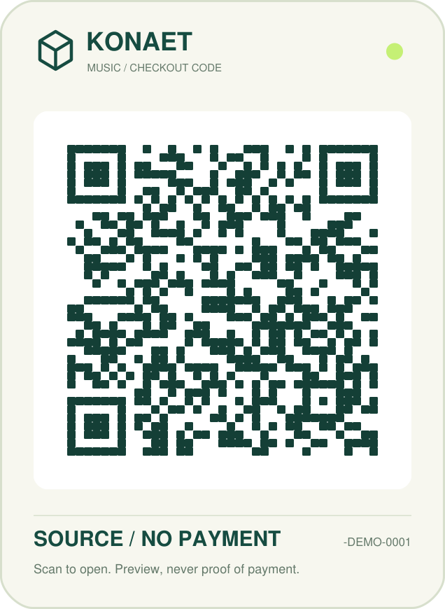
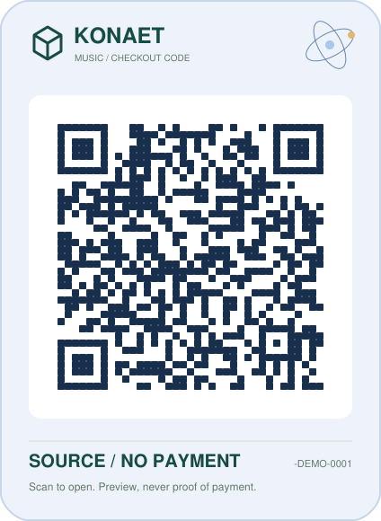
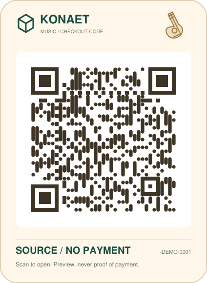
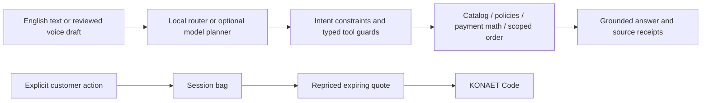

# KONAET Music

**A connected workspace. Music, public research, voice and a checkout code of your own.**

[Open the GitHub entrance](https://7dsol3.github.io/konaet-music/) ·
[Launch the HTTPS preview](https://emily-catalyst-joint-james.trycloudflare.com) ·
[Open the Sound Lab](https://emily-catalyst-joint-james.trycloudflare.com/sound-lab) ·
[Audio methods](docs/SOUND-LAB.md) · [Digital hardware](docs/AUDIO-HARDWARE.md)

The HTTPS preview connects through an accountless Cloudflare tunnel to a local Python/model
host. The host and tunnel must remain running; this is not a continuously hosted
production backend. GitHub Pages hosts the permanent entrance. Checkout QR links
use the public HTTPS workspace origin. Payments and wallets use sandbox credits only.

[](https://github.com/7dsol3/konaet-music/actions/workflows/checks.yml)

This is the **separate product evolution** of the submitted
[Empório da Música technical case](https://github.com/7dsol3/emporio-musica-ai-agent).
The original submission is preserved at revision
`aefc6f54191eb00c52d7a9f8df85c1c3a201c5b6`. Its history is retained here;
new work belongs to this repository. [Scope and decisions](docs/EVOLUTION.md).

The customer interface and replies are in **English**. Catalog prices remain
in **BRL**. The store, inventory and customer fixtures are fictional supplied
case data. No real purchase, stock reservation, refund or charge is executed.

## Explore the product

- Browse 65 recorded instruments by category, brand, model, availability and budget.
- Compare two or three instruments using recorded specifications.
- Open a product, add it to a session bag and change quantities.
- Prepare a server-calculated, fifteen-minute checkout preview with a unique KONAET Code.
- Download the original vector code or open the quote on another device when deployed on HTTPS.
- Ask KONAET about instruments, prices, installments, store policies and a verified fixture order.
- Dictate English commands, review the transcript and send it. Spoken replies are opt-in.
- Install the responsive PWA on supported devices. Every command also works by typing.
- Research public knowledge, scholarly metadata and code with dated source links.
- Switch the voice/text assistant between the music desk and explicit research scopes.
- Inspect actual connection states and export source briefs from the current tab.
- Try a private test wallet, approve/decline a sandbox transaction and verify its sealed receipt.
- Export a private opening compatible with the Sovereign receipt SDK, without submitting to a network.
- Explore a Python/SystemVerilog credit gate and its logical trace in the hardware lab.
- Play named notes, build triads, use a metronome and export a project-authored four-chord study.
- Tune a sustained note with explicit microphone permission; analyze a local audio file without uploading it.
- Ask checked music rules to explain a pitch/triad estimate, with an optional, clearly named model suggestion.
- Generate phase controls for the H-01 digital audio core, hear its reference voice and inspect exact PCM metrics.

The **2.2 Sound Lab** is a separate, lazy page at `/sound-lab`. Its browser DSP is
project code, not a trained song-recognition model. H-01 includes synthesizable
SystemVerilog for three phase voices, exact level/energy meters and I²S transmit
and receive paths. The live site executes the reference model; no physical FPGA,
microphone board or DAC is connected to the server.

[Methods and limits](docs/SOUND-LAB.md) · [Hardware interfaces and equations](docs/AUDIO-HARDWARE.md) ·
[Production gates](docs/PRODUCTION-GATES.md) · [External-runtime comparison protocol](docs/RUNTIME-COMPARISON.md)

The glass design uses CSS gradients, bounded translucency and small original
SVG illustrations. No external fonts, animation framework, video background or
per-frame rendering loop is loaded. Mobile layouts and reduced-motion and
reduced-transparency preferences have dedicated styles. These are implemented
features, not a claim of verified performance on every phone.

## Run locally

Python 3.11 or 3.12 is recommended. No paid key is required for the local mode.

```powershell
py -3.12 -m venv .venv
.\.venv\Scripts\python.exe -m pip install -r requirements-runtime.lock
.\.venv\Scripts\python.exe -m pip install --no-deps --no-build-isolation -e .
.\.venv\Scripts\python.exe -m emporio serve
```

Open **http://127.0.0.1:8000**. Alternatively, double-click **Run Offline.cmd**.
The default agent uses explicit local rules and the same authoritative tools.
It is a deterministic router, not a neural language model.

For an actual local neural planner on Windows x64:

```powershell
.\.venv\Scripts\python.exe scripts/local_model.py setup
.\.venv\Scripts\python.exe scripts/local_model.py app
```

Or double-click **Run Demo.cmd**. Setup verifies approximately 665 MB of official
Qwen3-0.6B Q8_0 and llama.cpp assets before loading them. Qwen is an **external
inference model**, not weights trained by KONAET. Engine files are compared
against the pinned archive before execution. [Provenance](docs/PROVENANCE.md).

The terminal commands remain available:

```text
python -m emporio chat --language en
python -m emporio verify-audit
```

## KONAET Code



The illustration above is an actual scannable **source-link demonstration**.
It opens this repository. It is not a payment request or an active checkout.

Real application codes identify individual checkout previews. The backend
creates a cryptographically random reference, recalculates current prices,
checks quantities, applies eligible PIX pricing without stacking promotions,
and binds the result to an expiring immutable quote. Retrying the same request
for an unchanged bag returns the same quote. Changed contents require a new request.

The QR encoder is **Segno**, with high error correction and a four-module quiet
zone. KONAET's vector composition, brand, colors, framing and checkout binding
are implemented in [konaet_code.py](emporio/konaet_code.py). Branding does not
cover the finder patterns or data. No third-party QR image service receives
the checkout URL. An independent ZXing decoder tests the actual rendered SVG
at two widths and three orientations.

Choose **Signature**, **Orbit** or **Studio** artwork. Each keeps the exact same
quote URL and unobstructed symbol. The drawings sit outside the quiet zone.
The data itself has three source-generated treatments: horizontal circuit traces,
connected constellation dots and vertical studio ribbons. Finder, alignment,
timing, format and version modules retain their exact square geometry. No custom
scanner is required; compatibility is checked with an independent QR decoder.
The server uses a versioned unit-rounding rule consistently in bag and quote;
fractional-cent regression tests and every available catalog product are checked.

| Orbit / science | Studio / guitar |
| --- | --- |
|  |  |

These two documentation codes open the GitHub entrance. Active checkout codes
are generated separately for their unique expiring quote.

The link is a capability: anyone holding it can view its **public product
quote** until expiry. No email, customer ID, chat or session cookie is encoded.
Shipping is excluded. Stock is not reserved. The QR itself never proves payment.

For real commerce, the merchant needs an authorized store backend and payment
account. The researched next integration is a provider-issued Pix request with
idempotency and verified server-side confirmation. It is **not implemented or
enabled by a payment key in this release**. [Payment boundary and research](docs/PAYMENTS.md).

KONAET's new [sandbox checkout](docs/CHECKOUT-SANDBOX.md) is implemented separately:
test credits, typed intent creation, an atomic terminal outcome, exactly-once
debit on retries/concurrent confirmation, and server-sealed receipts. It does
not create a Pix payment, reserve stock or replace a regulated payment network.

## Voice and commands

Press the microphone in the assistant to request browser speech recognition.
Nothing listens on page load. The English transcript becomes an editable draft;
you choose when to send it. Enable **Read replies aloud** to use available
browser speech synthesis. Closing the assistant stops capture and playback.

Try:

```text
Show acoustic guitars under BRL 1,000
Tell me about the first one
Can I pay for it in 12 installments?
Compare the first two
Add the first one to my bag
Show my bag
Prepare checkout
```

The last commands are explicit UI actions over already displayed product IDs.
They cannot charge a card, submit a bank transfer or authorize a refund.

SpeechRecognition support varies. Some browsers send audio to their own speech
service; this is **not guaranteed offline speech**. Unsupported or denied
microphones keep typed chat available. Real microphone, mobile-device and
speech-quality testing is still required. [Voice contract](docs/VOICE.md).

## How the agent works



Prices and policy outcomes come from checked tool results. Explicit category,
budget, product and transaction arguments cannot be widened by the model.
Order tools use session ownership in SQL. Private order requests bypass model
planning; provider context contains only allowlisted public product fields,
and order references are redacted from user history.

The local audit chain detects modification of existing receipts. It has no
external anchor and does not prevent an operator from replacing the entire
log. This product does not claim a Sovereign-finalized receipt or independent audit.

The inherited policy module remains version-pinned to the supplied PDF. Return
messages with missing packaging/materials now go to review rather than being
treated as fully satisfied. Ambiguous claims remain preliminary guidance.

## Configuration

| Variable | Purpose |
| --- | --- |
| `EMPORIO_PROVIDER` | `local` or `openai_compatible`; local is the default |
| `EMPORIO_MODEL_URL` | Native function-calling endpoint; HTTPS or HTTP loopback |
| `EMPORIO_MODEL` | Model ID accepted by your endpoint |
| `EMPORIO_MODEL_KEY` | Optional provider key, backend environment only |
| `EMPORIO_MODEL_TIMEOUT` | Planning timeout, 1–60 seconds |
| `EMPORIO_DATA_DIR` | Optional authorized replacement for the six original CSVs and manual |
| `EMPORIO_STATE_DIR` | Writable private state directory; defaults to the user's local state folder |
| `KONAET_PUBLIC_URL` | Trusted HTTPS origin used for checkout links; loopback is allowed for local use |
| `KONAET_MODEL_CACHE` | Optional directory holding verified neural-model assets |
| `KONAET_BRAVE_SEARCH_KEY` | Optional backend-only key for the general Web index; other documented public indexes work without it |
| `KONAET_GATEWAY_SECRET` | Preview-origin authentication, supplied only at runtime to the gateway and Python origin |

Variables are read from the process environment. `.env.example` is documentation,
not a file loader. A packaged wheel includes the case data and the web assets;
installation outside this checkout is tested.

## Host the Python application

The frontend and API must share an origin. Static GitHub Pages cannot execute
this Python/SQLite backend. A repository URL is not a hosted service.

An optional [Render demo blueprint](render.yaml) is included. It needs a Render
account, a connected copy of this repository and `KONAET_PUBLIC_URL` set to the
assigned HTTPS origin. It is not deployed automatically by cloning the code.
The free demo filesystem is ephemeral: sessions and quotes can disappear on
restart. Do not use it as a real merchant's order database.

For a Python host with an HTTPS reverse proxy:

```text
pip install -r requirements-runtime.lock
pip install --no-deps --no-build-isolation .
KONAET_PUBLIC_URL=https://your-demo.example PORT=8000 python scripts/serve.py
```

Set environment variables with your shell's syntax. The deployment entrypoint
requires the HTTPS origin, binds the assigned port and uses one process. A
production multi-instance service needs shared storage, verified customer
identity, independent rate limits, secrets management and monitoring.

## Verification

```text
python -m pip install -r requirements.lock
python -m pip install --no-deps --no-build-isolation -e .
python -m pytest
python scripts/verify_frontend.py
python scripts/verify_wheel.py
python scripts/capture_product_evidence.py
```

Interface event-contract tests run with Node 24.22.2:

```text
cd tests/ui
npm ci --ignore-scripts
cd ../..
node --test tests/ui/interface.test.mjs
```

These execute DOM events with API doubles. They do not render pixels or prove
physical microphone behavior. The native/browser-control bridge was unavailable
during implementation, so a new browser visual review is still outstanding.

See [2.1 validation and exact evidence](docs/VALIDATION-2.1.md) for the measured scope,
fresh model conversations, package tests and known limits. Historical screenshots
and `docs/ui-check.json` came from the original case and do not depict this redesign.

## Licensing and next work

Project-authored contributions use MIT. The frozen retrieval module retains
the Konaet Research and Commercial License, and the supplied case fixtures
retain their separate terms. The MIT license does not relicense those materials.
[Full notices](THIRD_PARTY_NOTICES.md). Qwen, llama.cpp, Segno and other dependencies
remain attributed to their authors.

OpenAI Codex assisted implementation, research, tests and documentation. The
project records observed failures and uses deterministic guardrails around
optional model planning. No claim of consciousness, general superiority,
original QR encoding, or outperforming Siri/Alexa is made.

Next: real browser/device accessibility and voice trials; authorized live-store
adapters; a payment-provider sandbox; broader unseen paraphrase evaluation;
measured concurrent-load testing and a production identity/storage architecture.
