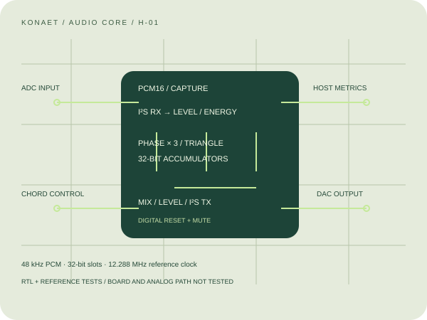

# KONAET H-01 digital audio core

H-01 is project-authored hardware-description code, a bit-exact reference and
testbenches. It is portable digital logic, not a fabricated board, a CPU replacement
or a trained language-model accelerator. The website runs a reference model.
No connected ADC, DAC, physical microphone or FPGA is asserted.

The [H-01A KiCad carrier](../hardware/h01-audio/README.md) now supplies an editable
schematic, routed two-layer board, local 3D models, STEP/GLB, BOM and review
fabrication outputs. It connects an external FPGA to a PCM5102A line DAC and an
external I²S microphone module. ERC, DRC and schematic parity pass with zero
violations; physical bring-up, target FPGA constraints and host bridge remain open.



## Modules and interfaces

| Module | Inputs / timing | Outputs / contract |
| --- | --- | --- |
| `audio_dds.sv` | Synchronous reset, sample enable, mute, 3-bit voice mask, three unsigned 32-bit phase increments | Registered signed PCM16; sample-valid pulse on enable |
| `audio_meter.sv` | Signed PCM16 plus accepted-sample valid | Each 64 accepted samples: unsigned peak, 38-bit exact square energy and 7-bit near-full-scale count |
| `audio_i2s_tx.sv` | 256-fs controller clock, stable mono PCM16 | BCLK=64 fs; 32-bit slots; 16 MSBs then zero padding; identical L/R; frame tick |
| `audio_i2s_rx.sv` | Same clock domain and controller-generated BCLK/WS; serial ADC data | Signed PCM16, channel and valid after the 16 MSBs; reacquires at WS transitions |
| `konaet_audio_core.sv` | Controller clock, synchronous controls and ADC serial data | I²S output, synth metrics and left-input metrics |

At fs=48 kHz, the reference controller clock is 12.288 MHz and BCLK is 3.072 MHz.
These are required nominal inputs/division ratios, not achieved FPGA timing.
Word-select changes one BCLK before the next word's MSB. Serial data changes on
the falling edge and is read at the rising edge, following the
[NXP I²S timing specification](https://www.nxp.com/docs/en/user-manual/UM11732.pdf).
The receiver accepts 16 MSBs of a 32-bit slot; this is not arbitrary-format negotiation.

All controls must already be synchronous. A future board bridge must latch a
complete parameter set atomically, cross clock domains correctly, validate ranges
and handle power/reset. No asynchronous host bus, DMA, network control bridge,
clock-domain crossing circuit or board pin constraints are supplied here.

## Integer equations

For MIDI note `m`, frequency is `440 × 2^((m−69)/12)` Hz. Phase increment is
`round(f × 2^32 / 48000)`, with modulo-2^32 accumulation. Reset starts each phase
at `0x40000000`. If `p=phase[31:16]`, the triangle sample is
`2p−32768` for `p<32768`, otherwise `98303−2p`. Three enabled voices are summed
in 18 signed bits and arithmetically shifted right by 3. The peak is bounded by
12,288 PCM units. There is no learned synthesis model or copyrighted sample bank.

The meter computes `peak=max(abs(x))`, `energy=Σx²` and
`clipped=Σ[abs(x)≥32700]`. In particular, `abs(-32768)=32768` is unsigned, and a
full negative block has energy `64×32768²=2^36`; the accumulator preserves it.
RMS can be derived on the host as `sqrt(energy/64)/32768`; dBFS uses `20 log10(RMS)`.
Valid gaps do not advance the block. Reset discards a partial block. Results hold
until a new block; `block_valid` is the only indicator that a fresh result exists.

The top-level transmitter latches the previous PCM word at a frame boundary;
the DDS then calculates the next word. Startup emits zero and incurs one frame
of pipeline delay. Input meters use the left channel. Digital mute takes effect
through this pipeline. It is not a substitute for amplifier mute, output protection,
smooth gain ramps or power-sequencing circuitry.

## Reproduce validation

On a system with Icarus Verilog and Yosys:

```sh
python scripts/verify_audio_gateware.py --synthesis
```

The testbench checks 4,096 clock vectors against independent integer models,
including reset, gaps, masks, phase wrap, signed extrema and clip thresholds.
It independently decodes 256 stereo I²S frames, checks WS delay and zero padding,
checks serial RX loopback and runs the connected top-level with output/input meters.
Generic Yosys synthesis and `check -assert` are mandatory when `--synthesis` is used.
CI runs it alongside the existing 1,536-vector ingress-gate suite. Source hashes
normalize line endings and bind the reference, RTL and testbench to the record.
No unavailable tool is replaced with a synthetic PASS.

Generic synthesis is not vendor place-and-route, clock-closure, resource fit,
power, EMI or physical testing. No clock-rate, LUT-count, real-time safety or
audio-fidelity benchmark is claimed without that separate evidence.

## Board integration specification — proposed

| Part / connection | Requirement | Status |
| --- | --- | --- |
| FPGA / development carrier | Sufficient logic and multipliers, 3.3 V-compatible digital I/O, supported toolchain | Not selected or tested on a physical board |
| Audio clock | Stable 12.288 MHz source or validated PLL / clock-enable architecture | ASE oscillator in H-01A design; jitter and timing unmeasured |
| Audio ADC / digital microphone | Controller-clocked I²S, 16 MSBs in 32-bit slots; compatible voltage | Proposed; not a PDM microphone input |
| Audio DAC / output stage | Compatible I²S controller timing, proper analog filtering / mute | PCM5102A with default mute and RC line filters designed; not powered or measured |
| Power | Regulated low-voltage supply, local decoupling and documented ground / analog routing | 5 V input, SS14 and TLV75533P with decoupling designed; bench review pending |
| Host | Board control bridge plus authenticated application interface | Browser/Python reference exists; no live bridge implemented |
| Enclosure / PCB | Connector geometry, thermal and EMC review, schematic, layout, DRC and bench measurements | H-01A PCB/3D and checks supplied; enclosure and physical tests pending |

There is no dependency on a Raspberry Pi to use the browser or synthesize this
portable core. A selected embedded host would need its own inference deployment,
audio-driver integration and capability measurements. Existing RealidadeQuantica
X01/X02 designs target sensors and temperature models; they are not presented as
validated audio boards. The next hardware milestone is a selected board, constrained
implementation, external I²S loopback capture and measured audio output.
