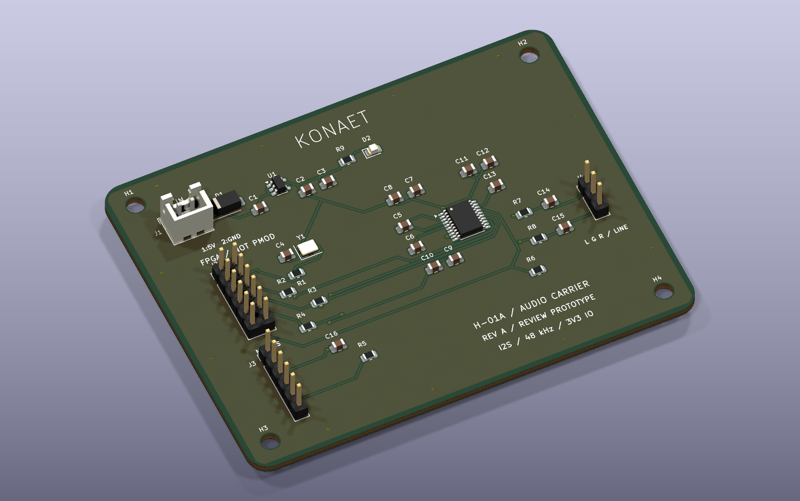

# KONAET H-01A — audio carrier

An editable **KiCad 10.0.8** project for the H-01 digital audio core. This revision
connects an **external FPGA** to a stereo line DAC and an external I²S microphone
module. It supplies the 12.288 MHz reference clock and the carrier's 3.3 V rail.
It does not contain an FPGA, inference processor, Wi-Fi radio or trained AI model.



**Review prototype.** ERC, DRC, schematic/PCB parity and all 105 connected pad
assignments pass. There are no waived DRC violations or disconnected nets.
Those results verify the design files; the board has not been fabricated,
powered, acoustically measured or approved for manufacture. See
[validation.json](validation.json) for source hashes and [bring-up](BRING-UP.md).

## Open and inspect

1. Open [konaet-h01.kicad_pro](konaet-h01.kicad_pro) with KiCad 10.0.8 or newer.
2. Open PCB Editor and press **Alt+3** for KiCad's interactive 3D Viewer.
3. Rotate, zoom, inspect both sides and toggle component visibility.
4. Open the Schematic Editor to inspect the named nets and manufacturer pins.

The project includes its footprint library and STEP models with relative paths.
It does not need a global library installation to view this design.
Y1 deliberately uses a **3225 crystal-shaped geometric proxy**; its appearance
is not an Abracon-certified mechanical model. All other models are the frozen
KiCad library models listed in [LIBRARIES.md](LIBRARIES.md).

| Deliverable | File |
| --- | --- |
| Schematic, editable / PDF | [KiCad schematic](konaet-h01.kicad_sch) · [PDF](schematic.pdf) |
| Routed PCB, editable / layer PDF | [PCB](konaet-h01.kicad_pcb) · [PDF](layout.pdf) |
| CAD assembly | [STEP](konaet-h01.step) · [GLB](konaet-h01.glb) |
| Rendered views | [Top](board-top.png) · [Bottom](board-bottom.png) |
| Parts and assembly | [BOM](bom.csv) · [Placement](placement.csv) |
| Review fabrication outputs | [Gerbers and drill files](fabrication) |
| Electrical specification | [Circuit manifest](circuit.json) · [Netlist](netlist.xml) |
| Check results | [ERC](erc.json) · [DRC + parity](drc.json) · [Export hashes](exports.json) |

## Electrical contract

85 × 65 mm, 1.6 mm nominal FR-4, two copper layers, four 3.2 mm mounting holes.
38 placements include four mounting holes; 34 placements have 3D models.
Minimum trace/clearance 0.20 mm, ground pours on both layers. Final stack-up,
manufacturing tolerances and solder-mask rules need the chosen fabricator's review.

* **J1:** pin 1 regulated +5 V input, pin 2 ground. Use 4.75–5.25 V and an external
  current-limited supply; no USB-PD negotiation, mains input or battery charger.
  SS14 provides series reverse-polarity protection. U1 is TLV75533PDBVR.
* **J2:** custom 2×6 header, **not PMOD**. Odd pins 1/3/5/7/9/11 are MCLK out,
  BCLK in, LRCLK in, DAC data in, microphone data out and DAC_UNMUTE in.
  Every even pin is ground. No supply rail is connected to J2. The FPGA is
  separately powered, uses 3.3 V I/O, and must share ground. Keep the cable short;
  source termination and signal integrity must be verified on the actual host.
* **J3:** 1=3.3 V output, 2=ground, 3=BCLK, 4=LRCLK, 5=mic serial data, 6=ground
  for a module's LR select. External I²S module only, not an analog or PDM mic.
  Budget ≤10 mA for the module. The host captures the left channel and the first
  16 significant bits of a 32-bit slot. A 24-bit I²S source loses its low 8 bits.
  Do not treat this header as a drop-in socket for every microphone board.
* **J4:** 1=left line output, 2=ground, 3=right line output. Use a line input with
  **≥10 kΩ** impedance. This is not a headphone or loudspeaker amplifier.

U2 PCM5102APWR uses 3-wire I²S, with SCK grounded and its BCLK PLL active.
FMT=0 selects I²S, FLT=0 normal latency, DEMP=0 de-emphasis off. XSMT has a
100 kΩ pull-down: output remains muted until the host explicitly drives J2.11 high.
Each line output has 470 Ω + 2.2 nF filtering (nominal RC corner ≈154 kHz).
The supply and charge-pump capacitors follow the manufacturer's application values.
The shared ground is intentional; this is not an isolated audio interface.

At 48 kHz: MCLK=256fs=12.288 MHz, BCLK=64fs=3.072 MHz. The existing
[SystemVerilog core](../../emporio/gateware/konaet_audio_core.sv) provides serial
TX/RX, three oscillator voices and peak/energy meters. A selected FPGA still
needs its own pin constraints, reset/unmute sequencing and host control bridge.
The website's synthesis/analysis is a software reference; opening the site does
not program or connect this board.

## Calculations and limits

The carrier budget is **100 mA maximum on the 3.3 V rail**, including a ≤10 mA
external mic module. It is a design allocation, not a measured current. At an
assumed 4.6 V LDO input, dissipation is `(4.6−3.3) × 0.1 = 0.13 W`; actual diode
drop, thermal rise, copper spreading and startup current require bench checks.
No 500 mA system capability is inferred from the regulator's headline rating.

The three-voice core is bounded to 12,288/32,768 full scale. The DAC's specified
full-scale line level is not a measurement of this board. Jitter, distortion,
noise, crosstalk and frequency response are **unmeasured**. Auto-routed traces were
checked geometrically; analog return paths and decoupling effectiveness need
engineering review before ordering. Unplanned power loss can still produce pops.

## Reproduce checks and exports

Using KiCad's bundled Python (or Linux Python with `pcbnew`):

```sh
python scripts/hardware/verify_h01.py --cli kicad-cli
python scripts/hardware/export_h01.py --cli kicad-cli
```

The validator runs real ERC and DRC with schematic parity, rejects all errors
and warnings, compares the schematic and PCB pads to `circuit.json`, checks
local 3D paths, geometry and source hashes. CI uses a pinned official KiCad image.
Exports are regenerated only after current source hashes pass.

To regenerate placement from code, `build_h01.py --library <KiCad share/kicad>`
**replaces the PCB with an unrouted placement**. Route its DSN with Freerouting
2.5.0, then `finish_h01.py --session <file.ses>`, `sync_h01_fields.py`, and validate.
The checked-in routed PCB is the reviewed result; routing is not asserted bitwise
deterministic. Do not run the placement generator over manual edits without a branch.

## Primary design references

* [TI PCM5102A, SLAS859C](https://www.ti.com/lit/ds/symlink/pcm5102a.pdf): pinout,
  hardware configuration, charge pump, filters and power sequencing.
* [TI TLV755P, SBVS320D](https://www.ti.com/lit/ds/symlink/tlv755p.pdf): DBV pinout,
  rail limits and capacitor requirements.
* [Abracon ASE series](https://abracon.com/Oscillators/ASEseries.pdf): 3.3 V
  oscillator, enable, output and package.
* [NXP I²S specification](https://www.nxp.com/docs/en/user-manual/UM11732.pdf):
  serial timing contract.

The design is original project integration of standard circuits, not a claim to
have invented I²S, these ICs or a processor superior to Siri/Alexa hardware.
